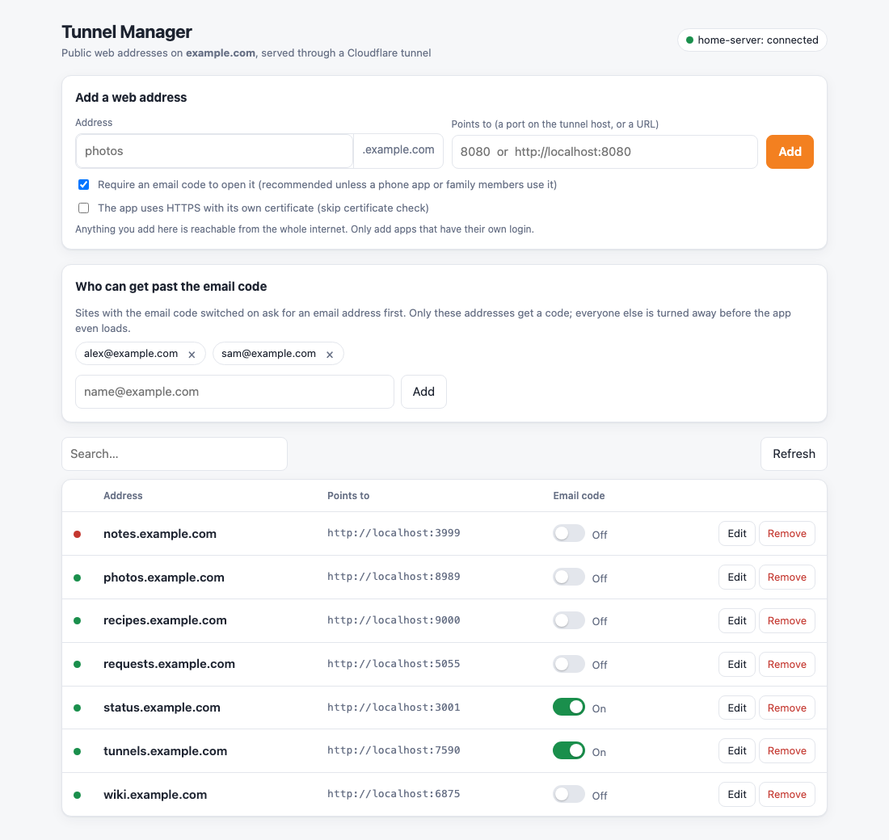

# Tunnel Manager

> **Unofficial.** This project is not affiliated with or endorsed by Cloudflare, Inc. "Cloudflare" is a trademark of Cloudflare, Inc.

A small self-hosted web page for managing the public hostnames of a **remotely-managed Cloudflare Tunnel**, without opening the Cloudflare dashboard.



- Lists the tunnel's public hostnames, what each one points to, and whether that local service is answering.
- Adds, edits, renames and removes hostnames. Each change updates the tunnel's ingress rules **and** the matching proxied `CNAME` record.
- Optional per-hostname **Cloudflare Access** switch: puts an email one-time-code login in front of a site, using one shared "allowed people" policy you edit on the page.
- Backs up the tunnel configuration to `backups/` before every change.
- One Python file plus one HTML page. **Standard library only**: no dependencies, runs in a plain `python:3-alpine` image.

## Safety first

Whoever can open this page can change your DNS and decide which of your services are on the internet. Before you use it:

- Always set `UI_PASSWORD`.
- Keep it on your LAN (the compose file binds it to `127.0.0.1`), or reach it over a VPN.
- If you publish it through the tunnel itself, protect that hostname with Cloudflare Access. You can do that from the page once Access is set up.
- The API token is powerful. Store it in `secrets/cf_token` (git-ignored) with tight file permissions, and give it only the permissions below.

## Cloudflare API token

Create a custom token at *My Profile → API Tokens*:

| Permission | Needed for |
|---|---|
| Account → Cloudflare Tunnel → Edit | reading and updating the tunnel's ingress rules |
| Zone → DNS → Edit | creating and removing the `CNAME` records |
| Zone → Zone → Read | finding the zone and its account |
| Account → Access: Apps and Policies → Edit | *optional*, for the email-code switch |

Scope the zone permissions to the one zone you're managing.

The Access switch also needs a login method. In Zero Trust go to *Integrations → Identity providers* and add **One-time PIN**. The page detects when one is missing and tells you.

## Requirements

- A tunnel that is **remotely managed** (created in the dashboard, or with `cloudflared tunnel create` and then migrated). Tunnels driven by a local `config.yml` ignore the API configuration.
- The zone (`CF_DOMAIN`) in the same Cloudflare account as the tunnel.

## Setup

```sh
git clone <this repo> tunnel-manager && cd tunnel-manager
cp .env.example .env                 # set CF_DOMAIN and UI_PASSWORD
mkdir -p secrets && chmod 700 secrets
printf '%s' 'YOUR_API_TOKEN' > secrets/cf_token && chmod 600 secrets/cf_token
docker compose up -d
```

Open http://localhost:7590. To run it without Docker, `set -a; . ./.env; python3 app.py` works too (Python 3.9+).

### Settings

| Variable | Default | |
|---|---|---|
| `CF_DOMAIN` | *(required)* | The zone, for example `example.com` |
| `UI_PASSWORD` | *(none)* | Basic-auth password. Any username works. |
| `CF_API_TOKEN` | — | The token, instead of `secrets/cf_token` |
| `CF_TUNNEL` | first healthy tunnel | Choose a tunnel by name |
| `CHECK_HOST` | `host.docker.internal` | Host used for the up/down dots when a rule points at `localhost` |
| `PORT` | `7590` | Listen port |
| `CF_API_BASE` | Cloudflare v4 API | Override for testing against a mock |

**Display names (optional):** Access apps are named after the subdomain (`my-app` becomes "My App"). To choose your own names, copy `friendly_names.example.json` to `friendly_names.json`.

`GET /healthz` returns `{"ok": true}` without auth, for uptime monitors.

## How it behaves

- Hostnames are matched case-insensitively, so rules added in the dashboard as `Foo.example.com` are still found.
- Settings already on a rule (path, other `originRequest` options) are kept when you edit it.
- It won't overwrite an existing DNS record that isn't a tunnel `CNAME`.
- Renaming moves the DNS record and, if the old name had a page-managed Access app, the protection too.
- Access apps created in the dashboard are shown as protected but read-only. The page only removes apps it created, which it tracks in `managed_access_apps.json`.
- Access changes can take a minute or two to take effect at Cloudflare's edge.

## Status

A small personal tool, shared as-is. It was tested against a mock of the Cloudflare API and in one real home setup, and has no automated test suite. Check the `backups/` folder exists and is being written before trusting it with a tunnel you care about. Issues and pull requests are welcome.

## License

MIT
